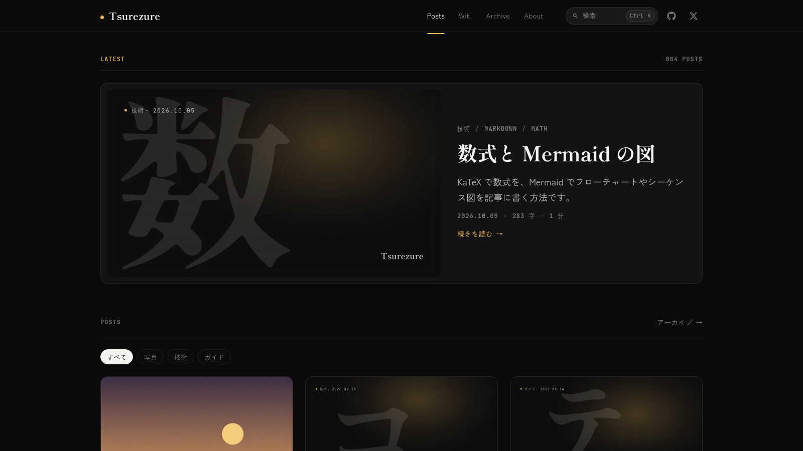

# Tsurezure — 徒然

A dark, Japanese-first Astro blog template with two layers of writing:
time-ordered **posts** and an optional **wiki** of pages grouped by concept.
Built to pair with the portfolio template
[Tomoshibi](https://github.com/c12o-dev/tomoshibi): same design tokens, and an
RSS feed that Tomoshibi's "latest posts" section reads as is.

[日本語の説明はこちら](#日本語)



More screenshots in [`docs/catalog/`](docs/catalog/): post, table of contents,
search, Mermaid, lightbox, wiki, archive, 404.

## Features

- **Astro 7, static output.** No adapter, no server. Deploy `dist/` anywhere.
- **Posts and a wiki.** Posts have categories, tags, drafts, scheduled
  publishing, related posts and prev/next links. The wiki groups pages by
  topic folder and shows an update timeline. Turn it off with one flag.
- **Markdown extras.** Expressive Code, KaTeX, Mermaid, admonitions (also the
  GitHub `> [!NOTE]` syntax), GitHub repository cards, photo cards, map cards,
  spoilers, and SVG charts drawn at build time from a YAML block.
- **Generated images.** Every post gets an OG image and, if it has no cover of
  its own, a cover image, both rendered from the title with Satori.
- **Search.** Pagefind index built after `astro build`, opened with ⌘K / Ctrl K.
- **Japanese typography.** Zen Kaku Gothic New and Shippori Mincho B1, subset
  and self-hosted; `palt`, `line-break: strict`, BudouX line breaks on OG
  images.
- **No inline scripts.** Every script is a bundled file, so the CSP in
  `public/_headers` keeps `script-src 'self'`.
- **Generated metadata.** RSS, sitemap with `lastmod`, `robots.txt`,
  `security.txt`, canonical URLs, Open Graph and JSON-LD from one config file.
- **Biome, Vitest and GitHub Actions.** Lint, typecheck, unit tests and build
  run in CI.

## Quick start

```bash
pnpm create astro@latest -- --template c12o-dev/tsurezure my-blog
cd my-blog
pnpm install
pnpm dev
```

Or click **Use this template** on GitHub. Node 22.12 or newer is required.

## Customize

1. **`src/config.ts`** — everything in one file:
   - `site`: title, subtitle, description, language, `url` (set this first;
     canonical URLs, the sitemap, RSS and OG URLs derive from it), and the
     `security.txt` contact.
   - `features`: `wiki`, `search` and the `share` buttons (`'x'`, `'copy'`).
   - `nav`, `profile` (name, bio, avatar, links), `license` (of your writing).
   - `og`: the domain label, kicker and glyphs drawn on OG images and covers.
   - `wiki.topics`: display names for wiki topic folders.
   - `expressiveCode.theme`: any Shiki theme.
   - `ui`: every fixed string in the interface.
2. **`src/content/`** — replace the samples: `posts/`, `wiki/`, and
   `pages/about.md`.
3. **Images** — `src/assets/avatar.png` (About page), and `public/favicon.svg`,
   `favicon.ico`, `apple-touch-icon.png`. The placeholders are a plain amber
   dot.

### Writing

```bash
pnpm new post my-first-post        # src/content/posts/my-first-post/index.md
pnpm new wiki web/cache-control    # src/content/wiki/web/cache-control.md
```

Post frontmatter:

| Field | Required | Notes |
| --- | --- | --- |
| `title` | yes | |
| `published` | yes | `YYYY-MM-DD` |
| `updated` | | shown on the post and used for the sitemap `lastmod` |
| `description` | | falls back to the first paragraph |
| `image` | | path relative to the post, e.g. `./cover.jpg`; otherwise a cover is generated |
| `category`, `tags` | | category filter on the home page, tag and category filters on /archive/ |
| `draft` | | `true` hides the post from production builds |
| `reviewed` | | with `draft: true`, publishes the post on its `published` date (below) |
| `slug` | | overrides the URL; defaults to the folder name |
| `lang` | | overrides `site.lang` for one post |

The sample posts show every Markdown extension with its syntax. The sample wiki
page `guide/wiki-pages` lists the wiki frontmatter.

### Scheduled publishing

Write a post with `draft: true`, set `reviewed: true` when it is ready, and
give it a future `published` date. `.github/workflows/publish-scheduled.yml`
runs daily at 18:00 JST, flips due posts to `draft: false`, commits and pushes
to the default branch; hosts that build on push redeploy from that commit.

- Allow the workflow to push: Settings → Actions → General → Workflow
  permissions → **Read and write**.
- Hosts that do not build on push: add a deploy hook URL as the repository
  secret `DEPLOY_HOOK_URL`. It is called only on days a post was published.
- Protected default branch: change the last step to open and merge a pull
  request instead of pushing.
- GitHub disables scheduled workflows after 60 days without repository
  activity.

### Turning off the wiki

Set `features.wiki: false`. The build then emits no `/wiki/` pages, and the nav
link, the home page section, the 404 link and the "WIKI" part of the OG kicker
disappear. `src/content/wiki/` can stay or go.

### Pairing with Tomoshibi

Set Tomoshibi's `feedUrl` to `https://<your blog>/rss.xml`. The feed is RSS 2.0
with `title`, `link`, `guid`, `pubDate`, `description`, `category` (category,
then tags) and `content:encoded` per post. Wiki pages are not in the feed.

### Switching language

Set `site.lang` and `site.ogLocale`, and translate `ui`. Components contain no
text of their own. Chart number formatting (`万`, `億`) and the reading-time
unit (characters) assume Japanese; see `src/utils/chart-svg.ts` and
`src/plugins/remark-reading-time.mjs`.

### Fonts

To change fonts: install other `@fontsource/*` packages, list their CSS files in
`SOURCES` at the top of `scripts/build-fonts.mjs`, update `--font-sans` /
`--font-serif` in `src/styles/tokens.css`, and point `src/utils/og-fonts.ts` at
static `.woff` files of the same families (Satori cannot read woff2).

## Deploy

`pnpm build` writes `dist/`, including the Pagefind index. Deploy it to any
static host.

The `SITE_URL` environment variable overrides `site.url` for one build, so a
preview or demo deployment gets correct canonical URLs without a code change:
`SITE_URL=https://preview.example.com pnpm build`.

- **Cloudflare Workers** — `wrangler.jsonc` is included (static assets,
  `404-page` handling). In Workers Builds set the build command to
  `pnpm run build` and the deploy command to `npx wrangler deploy`.
  `public/_headers` is honored.
- **Cloudflare Pages, Netlify** — build command `pnpm run build`, output
  directory `dist`. Both read `public/_headers` as is and offer deploy hooks.
- **Vercel** — ignores `_headers`. Copy the rules into `vercel.json`:

  ```json
  {
    "headers": [
      {
        "source": "/(.*)",
        "headers": [
          { "key": "Content-Security-Policy", "value": "default-src 'self'; script-src 'self' 'wasm-unsafe-eval'; style-src 'self' 'unsafe-inline'; img-src 'self' data: https://avatars.githubusercontent.com; font-src 'self'; connect-src 'self' https://api.github.com; base-uri 'none'; form-action 'none'; frame-ancestors 'none'; object-src 'none'; upgrade-insecure-requests" },
          { "key": "X-Content-Type-Options", "value": "nosniff" },
          { "key": "Referrer-Policy", "value": "strict-origin-when-cross-origin" }
        ]
      }
    ]
  }
  ```

- **GitHub Pages** — cannot set custom headers; the site works without the CSP.
  Serve it from the root of a domain (a custom domain or `<user>.github.io`):
  the template does not support a `base` path.

`public/fonts/` is generated during `pnpm build` and is not committed. If you
upload `dist/` by hand, build locally first.

### Scripts and the CSP

Every `<script>` in `dist/` is an external file under `/_astro/`; the only
inline `<script>` elements are JSON-LD, which browsers do not execute. That is
what lets `public/_headers` keep `script-src 'self'`:

| Script | Pages | What it does |
| --- | --- | --- |
| `Base.astro…js` | all | Loads the web fonts after first paint; loads PhotoSwipe on the first image click, Mermaid on pages with a diagram; fills GitHub cards; code copy button |
| `Header.astro…js` | all | ⌘K / Ctrl K hint, mobile menu |
| `Search.astro…js` | all, with `features.search` | Mounts the Svelte search modal; loads Pagefind on first open |
| `Toc.astro…js` | posts, wiki pages | Highlights the current heading in the table of contents |
| `ShareLinks.astro…js` | posts | "Copy link" button |
| `_...page_.astro…js` | home | Category filter |
| `archive.astro…js` | /archive/ | Tag and category filters from the query string |
| `ec.…js` | pages with code | Expressive Code: makes scrollable code blocks keyboard-focusable |
| `<script type="application/ld+json">` | posts, wiki pages | Structured data, not executed |

PhotoSwipe, Mermaid, Pagefind and the Svelte runtime are separate chunks,
fetched only when used.

The rest of the policy is looser than Tomoshibi's, each for a feature:

- `script-src 'wasm-unsafe-eval'` — Pagefind compiles its WebAssembly index.
- `style-src 'unsafe-inline'` — KaTeX and Expressive Code write `style`
  attributes, and Mermaid writes a `<style>` element into each SVG. None of
  these can be hashed ahead of time.
- `img-src data:` — the grain texture and icon masks in the CSS.
- `img-src https://avatars.githubusercontent.com`,
  `connect-src https://api.github.com` — the `::github` card.

Not using search, math, Mermaid or GitHub cards? Remove the matching sources.
Remote images in posts or in `::googlemap{image=…}` need their origin in
`img-src`.

`Cross-Origin-Resource-Policy: same-site` in `_headers` stops other sites from
hot-linking your images. Remove that line if you want to allow it.

## Scripts

| Command | What it does |
| --- | --- |
| `pnpm dev` | Generate fonts, start the dev server (search shows a placeholder) |
| `pnpm build` | Generate fonts, build `dist/` and the search index |
| `pnpm preview` | Serve `dist/` locally |
| `pnpm new post <slug>` | New post, dated today, as a draft |
| `pnpm new wiki <topic>/<page>` | New wiki page |
| `pnpm publish-scheduled` | Publish due scheduled posts (`--dry-run` to list them) |
| `pnpm check` / `pnpm fix` | Biome lint and format |
| `pnpm typecheck` | `astro check` |
| `pnpm test:unit` | Vitest |

The repository pins pnpm through `packageManager`. To use npm or yarn, delete
that field and `pnpm-lock.yaml`.

## License

MIT © 2026 [Seu](https://c12o.net). See [LICENSE](LICENSE). Issues and pull
requests are welcome.

---

## 日本語

日本語の組版を前提にした、ダーク固定の Astro ブログテンプレートです。日付順の
**記事**と、概念ごとにページを育てる **Wiki** の 2 層で書けます。ポートフォリオ用の
テンプレート [Tomoshibi](https://github.com/c12o-dev/tomoshibi) とデザイン
トークンが共通で、RSS をそのまま Tomoshibi の「最近の記事」に読み込めます。

### 特徴

- Astro 7 の静的出力。アダプタもサーバーも使いません
- 記事はカテゴリ・タグ・下書き・予約公開・関連記事・前後リンク付き。Wiki は
  トピック別の一覧と更新履歴を持ち、`features.wiki` で丸ごと無効にできます
- Markdown 拡張: Expressive Code、KaTeX、Mermaid、注記ブロック（GitHub の
  `> [!NOTE]` 記法も可）、GitHub カード、写真カード、地図カード、伏せ字、
  YAML から描く SVG グラフ
- 記事ごとの OG 画像と、画像のない記事のカバー画像を Satori で生成
- Pagefind による全文検索（⌘K / Ctrl K）
- Zen Kaku Gothic New / Shippori Mincho B1 をサブセット化して同梱
- inline script を出さないので、`public/_headers` の CSP は `script-src 'self'`
- RSS、lastmod 付き sitemap、robots.txt、security.txt、OG、JSON-LD を設定から生成

### 使い方

```bash
pnpm create astro@latest -- --template c12o-dev/tsurezure my-blog
cd my-blog
pnpm install
pnpm dev
```

1. `src/config.ts` — まず `site.url` を設定し、サイト名・説明・`features`・
   ナビゲーション・プロフィール・OG 画像の文字・Wiki のトピック名・`ui` の文言を
   書き換える
2. `src/content/` — サンプルの記事（`posts/`）、Wiki（`wiki/`）、
   `pages/about.md` を置き換える
3. `src/assets/avatar.png` と `public/favicon.*`、`apple-touch-icon.png` を差し替える

記事は `pnpm new post <slug>`、Wiki は `pnpm new wiki <topic>/<page>` で作れます。
サンプル記事に、各 Markdown 拡張の書き方と表示例があります。

### 予約公開

`draft: true` で書き、公開してよくなったら `reviewed: true` にして、`published`
に公開日を入れます。`.github/workflows/publish-scheduled.yml` が毎日 18:00（JST）
に動き、公開日を迎えた記事を `draft: false` にしてコミット・push します。push で
再ビルドするホストなら、それで公開されます。

- リポジトリの Settings → Actions → General → Workflow permissions を
  「Read and write」にする
- push で再ビルドしないホストでは、Deploy Hook の URL を secret
  `DEPLOY_HOOK_URL` に登録する（記事を公開した日だけ呼ばれる）
- 既定のブランチを保護している場合は、最後の手順をプルリクエストの作成とマージに変える

### Tomoshibi との組み合わせ

Tomoshibi の `feedUrl` に `https://<ブログのドメイン>/rss.xml` を設定します。RSS は
記事ごとに `title`、`link`、`guid`、`pubDate`、`description`、`category`、
`content:encoded` を持ち、Wiki は含みません。

### デプロイ

`pnpm build` で `dist/`（検索インデックスを含む）ができます。Cloudflare Workers 用の
`wrangler.jsonc` を同梱しています（Workers Builds のデプロイコマンドは
`npx wrangler deploy`）。Cloudflare Workers / Pages と Netlify は
`public/_headers` をそのまま読みます。Vercel は `vercel.json` に書き写し、
GitHub Pages はカスタムヘッダを設定できません（CSP 無しで動きます。`base` の
サブパス配信には対応していないので、独自ドメインか `<user>.github.io` の直下で
配信してください）。環境変数 `SITE_URL` を設定すると、そのビルドだけ `site.url`
を上書きできます。

CSP は `script-src 'self'` を保っています。`dist/` の `<script>` はすべて
`/_astro/` 以下の外部ファイルで、inline は実行されない JSON-LD だけです（一覧は
英語の Deploy 節）。そのほかの緩和はそれぞれ機能のためです: Pagefind の
WebAssembly に `'wasm-unsafe-eval'`、KaTeX・Expressive Code・Mermaid がスタイルを
直接書き込むため `style-src 'unsafe-inline'`、CSS のテクスチャとアイコンに
`img-src data:`、GitHub カードに `api.github.com` と `avatars.githubusercontent.com`。

### ライセンス

MIT © 2026 [Seu](https://c12o.net)
