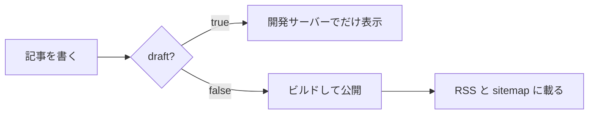
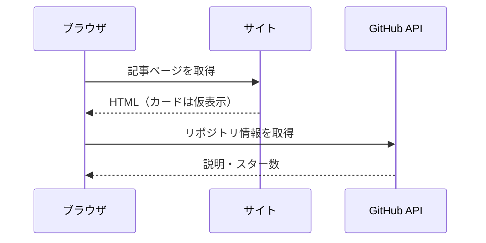

数式は [KaTeX](https://katex.org/) でビルド時に HTML にします。図は [Mermaid](https://mermaid.js.org/) の記法で書き、閲覧時にブラウザで SVG にします。Mermaid のスクリプトは、図があるページでだけ読み込みます。

## 数式

文中の数式は `$` で囲みます。たとえば $E = mc^2$ や $\sqrt{a^2 + b^2}$ のように書きます。

独立した行の数式は `$$` で囲みます。

$$
\sum_{k=1}^{n} k = \frac{n(n+1)}{2}
$$

行列や場合分けも書けます。

$$
f(x) =
\begin{cases}
  x^2 & (x \ge 0) \\
  -x & (x < 0)
\end{cases}
\qquad
A = \begin{pmatrix} 1 & 2 \\ 3 & 4 \end{pmatrix}
$$

## Mermaid

言語名を `mermaid` にしたコードブロックが図になります。

シーケンス図の例です。

Mermaid の配色は、ページを読み込んだときにデザイントークンの値を読んで決めます。`src/styles/tokens.css` の色を変えると、図の色も変わります。
