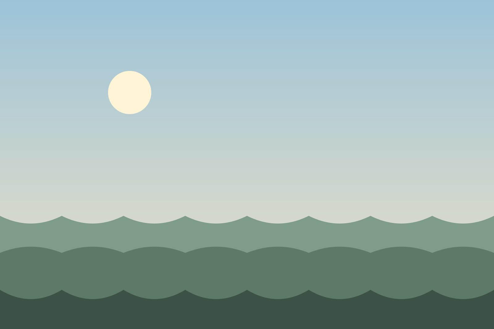
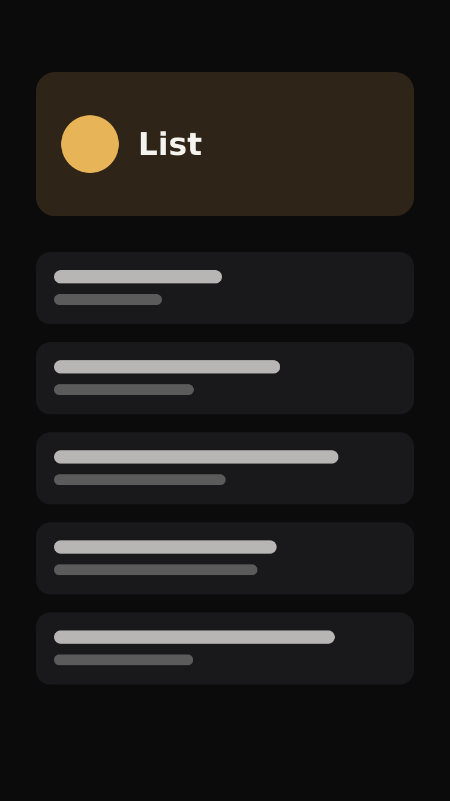
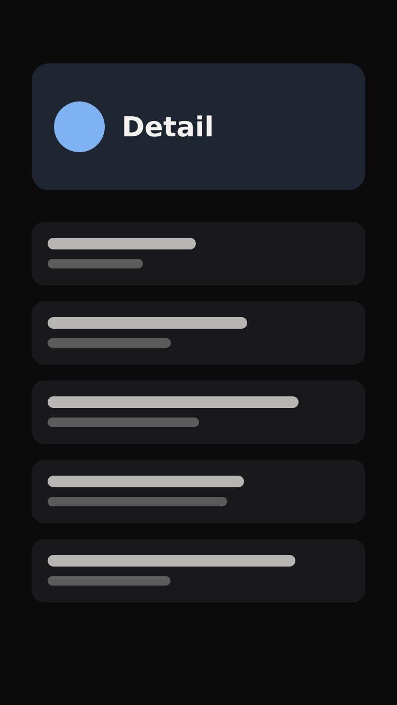

この記事では、frontmatter の `image` に `./dusk.jpg` を指定しています。指定した画像は、記事の先頭と一覧のカードに使われます。指定しない記事は、タイトルの文字から生成したカバー画像になります。

画像は記事と同じフォルダに置き、相対パスで参照します。ビルド時に WebP に変換され、表示幅に合ったサイズが選ばれます。

## 写真カード

`:::photo` で囲むと、写真にキャプションが付きます。

:::photo{title="朝の稜線。キャプションは title 属性に書きます"}

:::

:::photo{title="夜の稜線"}

:::

本文中の画像はクリックすると拡大します。拡大表示には [PhotoSwipe](https://photoswipe.com/) を使っていて、最初にクリックしたときにだけスクリプトを読み込みます。

## スマートフォンの画面を並べる

縦長のスクリーンショットは `:::photosm` で幅を抑え、`::::photorow` で横に並べます。外側の `::::` は内側の `:::` より 1 つ多くコロンを書きます。

::::photorow
:::photosm{title="一覧画面"}

:::

:::photosm{title="詳細画面"}

:::
::::

画面の幅が狭いときは、並べたカードが縦に折り返します。

## 普通の画像

カードを使わない画像は、そのまま本文の幅で表示されます。

