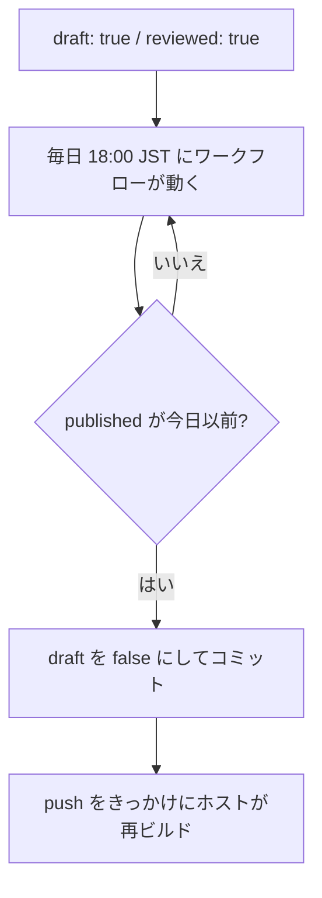

記事を書き溜めておき、決めた日に公開したいときに使います。仕組みは frontmatter の 2 つのフラグと、毎日動く GitHub Actions のワークフローです。

## フラグの組み合わせ

| `draft` | `reviewed` | 状態 |
| --- | --- | --- |
| `true` | `false` | 書きかけ。公開されない |
| `true` | `true` | 予約済み。`published` の日付になったら公開される |
| `false` | — | 公開中 |

`draft: true` の記事は、本番のビルドに含まれません。開発サーバー（`pnpm dev`）では表示されるので、仕上がりを確認できます。

## 公開の流れ

ワークフローは `.github/workflows/publish-scheduled.yml` です。`scripts/publish-scheduled.mjs` が対象の記事を探し、`draft: true` を `draft: false` に書き換えて `reviewed` の行を消します。変更があれば、既定のブランチにコミットして push します。

## 準備

- リポジトリの Settings → Actions → General で、Workflow permissions を「Read and write」にする
- ホストが push を検知して再ビルドしない場合は、ホストの Deploy Hook の URL をリポジトリの secret `DEPLOY_HOOK_URL` に登録する。公開した記事があった日だけ呼び出される

:::warning
GitHub は、60 日間コミットのないリポジトリの定期実行ワークフローを止めます。しばらく更新しない期間があるときは、Actions の画面から再度有効にしてください。
:::

:::note
既定のブランチを保護していて直接 push できない場合は、ワークフローの最後の手順を、プルリクエストを作ってマージする形に変えてください。
:::
